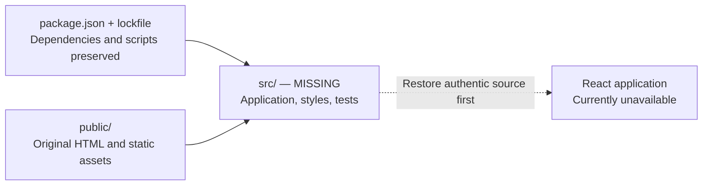

# Aura Tracker

A partial snapshot of a React/TypeScript project intended to analyze speech for
TikTok-style “aura,” with speaker profiles and optional voice responses.

> **Source missing — this snapshot cannot run.** Neither recorded commit contains
> `src/`. No authentic application source was found in the recovery search.



```text
AuraTracker/
├── public/               Original HTML, icons, manifest, robots.txt
├── docs/                 Recovery evidence and historical feature notes
├── package*.json         Original dependencies and npm scripts
└── tsconfig.json         Expects the missing src/ directory
```

| Start here | What it contains |
| --- | --- |
| [Recovery guide](docs/recovery.md) | Search scope, missing files, restoration and setup steps |
| [Historical project notes](docs/historical-project-notes.md) | Original feature descriptions and usage, unverified |
| [Package manifest](package.json) | Preserved `start`, `build`, `test`, and `eject` scripts |

**Setup is blocked by missing source.** Installing dependencies alone will not
restore the app. Keep Gemini and ElevenLabs credentials on a server; never put
provider keys in browser source, public assets, or client environment variables.
